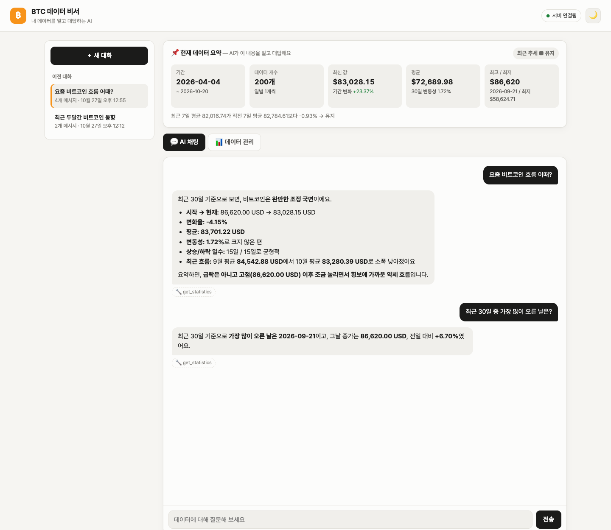
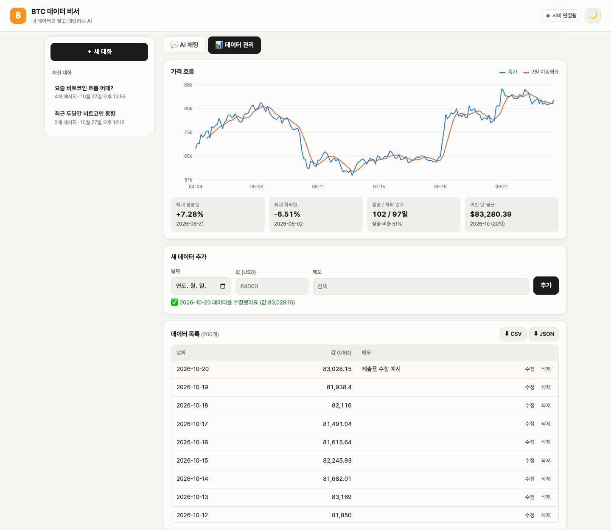
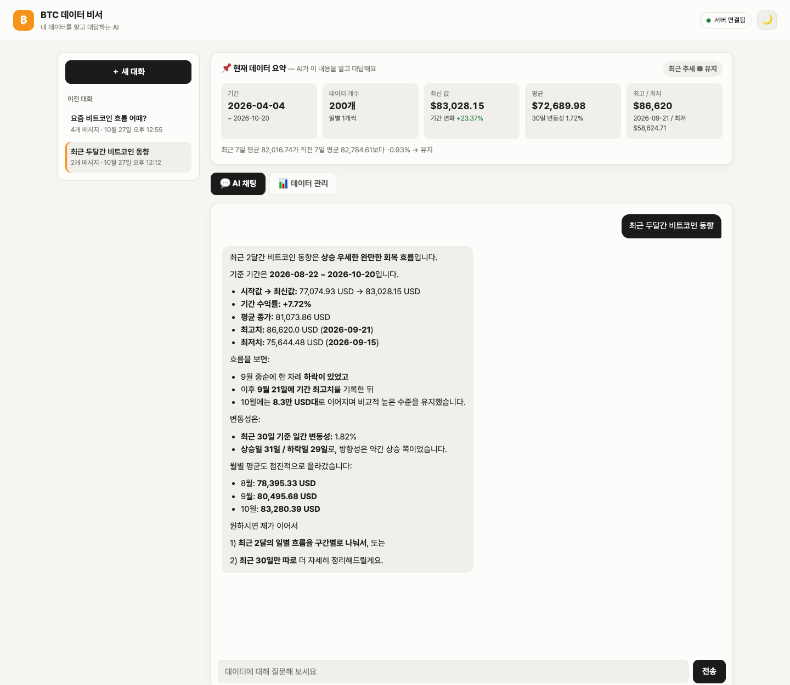
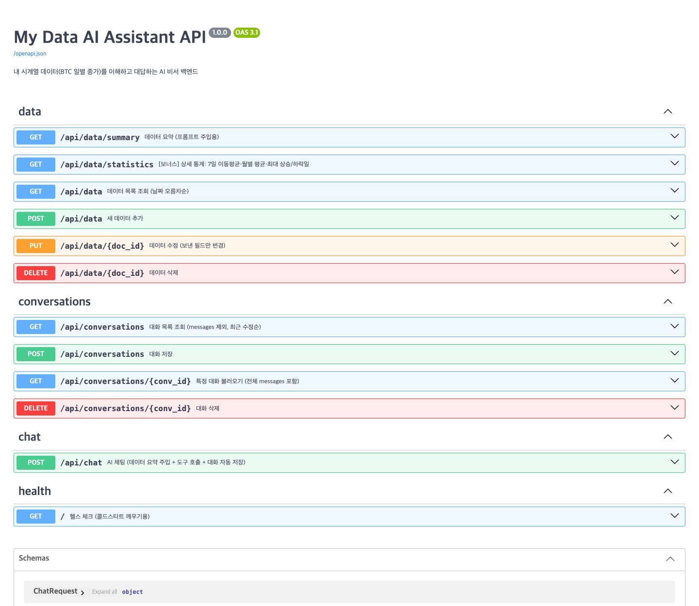

# ₿ BTC 데이터 비서 — 내 데이터를 아는 AI

일반 ChatGPT는 "요즘 비트코인 흐름 어때?"라고 물어도 **내가 가진 데이터**를 모릅니다.
이 서비스는 내가 저장한 **비트코인 일별 종가 200일치**를 분석해 요약을 만들고,
그 요약을 AI의 시스템 프롬프트에 넣어서 **내 데이터 기준으로** 대답하게 합니다.
데이터는 화면에서 직접 추가·수정·삭제할 수 있고, 바뀐 데이터는 곧바로 요약과 AI 답변에 반영됩니다.

> 데이터 출처: 이전 미션(M1-1)에서 바이낸스 API로 수집한 BTC/USDT 일봉 중 최근 200일 (2026-04-04 ~ 2026-10-20)

## 배포 URL

| 구분 | URL |
|---|---|
| 프론트엔드 (Vercel) | `TODO` |
| 백엔드 API (Render) | `TODO` |
| Swagger UI | `TODO/docs` |

> ⏳ 백엔드는 Render 무료 플랜이라 15분 동안 요청이 없으면 잠듭니다. 첫 접속은 **최대 50초쯤** 걸릴 수 있고,
> 그동안 화면 상단에 "서버 깨우는 중" 안내가 뜨고 자동으로 다시 연결을 시도합니다.

## 기술 스택

| 영역 | 사용 기술 |
|---|---|
| 백엔드 | Python 3.12, FastAPI, Uvicorn, Pydantic v2 |
| DB | Firebase Firestore (`firebase-admin`) |
| AI | OpenAI Chat Completions API (`gpt-4o-mini`) + Function Calling |
| 프론트엔드 | HTML / CSS / JavaScript (프레임워크 없음), 그래프는 SVG 직접 그리기 |
| 배포 | Render (백엔드), Vercel (프론트엔드) |

## 주요 기능

1. **데이터 기반 AI 채팅** — 질문하면 데이터 요약을 반영해 답변, 답변 생성 중 로딩 표시, AI가 호출한 도구(🔧) 표시
2. **데이터 관리(CRUD)** — `(date, value, memo)` 추가/수정/삭제, 목록 즉시 갱신, 저장 결과 메시지
3. **대화 기록** — 채팅하면 자동 저장, 왼쪽 목록에서 클릭하면 그 대화를 다시 불러와 이어서 질문 가능, 삭제
4. **데이터 요약 카드** — 기간·개수·최신값·평균·최고/최저·최근 추세(증가/감소/유지)
5. **보너스** — 상세 통계 API, 종가+7일 이동평균 그래프(마우스 오버 툴팁), CSV/JSON 내보내기, 다크 모드, Function Calling

## 폴더 구조

```
├── backend/
│   ├── main.py                  # FastAPI 앱: CORS, 라우터 연결, 공통 예외 처리
│   ├── app/
│   │   ├── config.py            # 환경 변수 읽기 (키는 전부 여기로만 들어옴)
│   │   ├── db.py                # 저장소 계층: Firestore / 메모리(로컬 테스트용)
│   │   ├── schemas.py           # Pydantic 요청·응답 검증 규칙
│   │   ├── routers/             # URL ↔ 함수 연결만 담당 (HTTP 층)
│   │   │   ├── data.py          #   /api/data ...
│   │   │   ├── conversations.py #   /api/conversations ...
│   │   │   └── chat.py          #   /api/chat
│   │   └── services/            # 실제 로직 (라우터와 분리)
│   │       ├── summary.py       #   시계열 분석 → 요약·통계
│   │       ├── data_service.py  #   데이터 CRUD
│   │       ├── conversation_service.py
│   │       └── chat_service.py  #   컨텍스트 주입 + GPT 호출 + 도구 실행 + 자동 저장
│   ├── data/btc_daily.csv       # 초기 데이터 200일
│   ├── scripts/seed_firestore.py# CSV → Firestore 업로드 (1회)
│   ├── requirements.txt
│   └── .env.example
├── frontend/
│   ├── index.html / style.css / app.js
│   ├── build.sh                 # Vercel 빌드 시 API_BASE_URL → config.js 생성
│   └── vercel.json
├── render.yaml                  # Render 배포 설정
└── docs/screenshots/            # 제출 스크린샷
```

### 왜 이렇게 나눴나 (라우터 / 서비스 / 저장소)

- **routers**: "어떤 URL로 오면 어떤 함수를 부를지"만 안다. HTTP 상태 코드·응답 형식 담당.
- **services**: 실제 일(요약 계산, GPT 호출, 중복 날짜 검사)을 한다. 같은 요약 함수를
  `/api/data/summary`와 `/api/chat`이 함께 쓰므로 계산이 한곳에만 있다.
- **db.py**: Firestore를 직접 만지는 코드는 여기에만 있다. 그래서 키 없이도 `STORAGE=memory`로
  같은 코드를 돌려 볼 수 있고, 나중에 DB를 바꿔도 서비스 코드는 그대로다.

## API

| 메서드 | 경로 | 설명 |
|---|---|---|
| POST | `/api/data` | 새 데이터 추가 (같은 날짜가 있으면 409) |
| GET | `/api/data?start=&end=` | 데이터 목록 (날짜 오름차순, 기간 필터 선택) |
| PUT | `/api/data/{id}` | 데이터 수정 (보낸 필드만 변경) |
| DELETE | `/api/data/{id}` | 데이터 삭제 |
| GET | `/api/data/summary` | 데이터 요약 (프롬프트 주입용) |
| GET | `/api/data/statistics` | [보너스] 7일 이동평균·월별 평균·최대 상승/하락일·상승/하락 일수 |
| POST | `/api/conversations` | 대화 저장 |
| GET | `/api/conversations` | 대화 목록 — **messages는 포함하지 않음** (`message_count`, `preview`만) |
| GET | `/api/conversations/{id}` | 특정 대화 불러오기 — **전체 messages 포함** (요구사항 (A) 방식) |
| DELETE | `/api/conversations/{id}` | 대화 삭제 |
| POST | `/api/chat` | AI 채팅 (요약 주입 → GPT → 대화 자동 저장) |

### Firestore 컬렉션 구조

```
data/{자동ID}
  date: "2026-10-20"   value: 83028.15   memo: ""   created_at   updated_at

conversations/{자동ID}
  title: "최근 일주일 추세 어때?"
  messages: [ {role: "user"|"assistant", content, created_at}, ... ]
  created_at   updated_at
```

### 입력 검증 (Pydantic)

| 필드 | 규칙 | 틀리면 |
|---|---|---|
| `date` | 실제 존재하는 날짜 (YYYY-MM-DD) | 422 |
| `value` | 0보다 크고 1천만 이하, NaN·무한대 불가 | 422 |
| `memo` | 200자 이하, 앞뒤 공백 제거 | 422 |
| 수정 요청 | date/value/memo 중 최소 1개 | 422 |
| 같은 날짜 중복 | 하루에 값 1개만 | 409 |
| `message` (채팅) | 1~1000자, 공백만은 불가 | 422 |

라우터 함수까지 오기 전에 FastAPI가 자동으로 막아 주므로, 잘못된 값이 DB에 들어갈 수 없습니다.
예상하지 못한 에러는 공통 핸들러가 받아 내부 정보 없이 `500 "서버 내부 오류"`로만 응답합니다.

## 시계열 분석 → 요약 → 컨텍스트 주입

```
Firestore data (200일)
   │  build_summary()
   ▼
요약: 기간 / 개수 / 최신값 / 평균 / 최고·최저(날짜) / 기간 변화율 / 최근 추세 / 30일 변동성
   │  summary_to_prompt()
   ▼
시스템 프롬프트 "[사용자 데이터 요약] ..." 에 삽입
   │
   ▼
GPT 호출 ── 요약만으로 부족하면 도구 호출 ──► get_data_range / get_statistics ...
   │                                              (서버가 실행해 결과를 다시 GPT에게)
   ▼
최종 답변 → conversations에 질문·답변 자동 저장 → 화면 표시
```

- **최근 추세 판단**: 최근 7일 평균을 직전 7일 평균과 비교해 +2% 초과면 `증가`, -2% 미만이면 `감소`, 그 사이면 `유지`
- **왜 요약을 넣나**: 200일치 원본을 매번 통째로 보내면 토큰(=비용)이 많이 들고 느립니다.
  핵심 숫자만 요약해서 넣고, 세부가 필요할 때만 AI가 도구로 꺼내 보게 해서 비용과 정확도를 함께 잡았습니다.

### [보너스] Function Calling — 어떤 근거로 어떤 도구를 부르나

| 도구 | AI가 부르는 경우 (예시 질문) |
|---|---|
| `get_data_range(start_date, end_date)` | "10월 15일 값은?", "9월 한 달 흐름 요약해줘" — 요약에 없는 특정 날짜·기간이 필요할 때 |
| `get_statistics()` | "가장 크게 오른 날은?", "월별 평균 알려줘" — 이동평균·월별·최대 상승일 등 상세 지표 |
| `get_data_summary()` | 데이터가 바뀐 뒤 최신 요약을 다시 확인할 때 |
| `list_conversations()` | "전에 내가 뭐 물어봤지?" — 이전 대화 목록이 필요할 때 |

도구 설명(description)과 시스템 프롬프트의 규칙을 보고 GPT가 스스로 고르며,
화면에서는 답변 아래 `🔧 get_statistics` 처럼 실제로 호출된 도구가 표시됩니다.
비용 보호를 위해 도구 호출은 최대 3번, 답변은 최대 600토큰으로 제한했습니다.

## 로컬 실행 방법

### 1) 백엔드

```bash
cd backend
python3 -m venv .venv
.venv/bin/pip install -r requirements.txt
cp .env.example .env          # 값 채우기 (아래 환경 변수 표 참고)
.venv/bin/python -m scripts.seed_firestore   # 처음 1번만: CSV 200일 → Firestore
.venv/bin/uvicorn main:app --reload           # http://127.0.0.1:8000/docs
```

> 키 없이 화면만 먼저 보고 싶다면 `STORAGE=memory .venv/bin/uvicorn main:app --reload`
> (CSV 데이터가 메모리에 자동으로 채워지고, 서버를 끄면 사라짐. 채팅은 OpenAI 키가 있어야 동작)

### 2) 프론트엔드

```bash
cd frontend
echo 'window.APP_CONFIG = { API_BASE_URL: "http://127.0.0.1:8000" };' > config.js
python3 -m http.server 5500   # http://127.0.0.1:5500
```

## 환경 변수

### 백엔드 (Render / `backend/.env`)

| 이름 | 필수 | 설명 |
|---|---|---|
| `OPENAI_API_KEY` | ✅ | OpenAI API 키 |
| `FIREBASE_SERVICE_ACCOUNT_JSON` | ✅ (배포) | 서비스 계정 키 JSON **내용 전체**를 한 줄 문자열로 |
| `FIREBASE_SERVICE_ACCOUNT_PATH` | (로컬 대안) | 서비스 계정 키 파일 경로 — 위 JSON 대신 사용 가능 |
| `ALLOWED_ORIGINS` | ✅ | CORS 허용 프론트 주소, 쉼표 구분 (예: `https://xxx.vercel.app`) |
| `OPENAI_MODEL` | | 기본 `gpt-4o-mini` |
| `OPENAI_MAX_TOKENS` | | 답변 최대 토큰, 기본 `600` |
| `STORAGE` | | `firestore`(기본) 또는 `memory` |

### 프론트엔드 (Vercel)

| 이름 | 필수 | 설명 |
|---|---|---|
| `API_BASE_URL` | ✅ | 백엔드 주소 (예: `https://xxx.onrender.com`). 빌드 때 `build.sh`가 `config.js`로 만들어 줌 |

### 왜 CORS·환경 변수·키 관리가 필요한가

- **CORS**: 프론트(vercel.app)와 백엔드(onrender.com)는 도메인이 달라서, 브라우저가 기본적으로 요청을 막습니다.
  백엔드가 "이 주소는 허용"이라고 알려 줘야 하고, 아무 사이트나 허용하지 않도록 내 프론트 주소만 등록합니다.
- **환경 변수**: 로컬·배포 환경마다 주소와 키가 다릅니다. 코드를 고치지 않고 설정만 바꿔 같은 코드를 돌리기 위해서입니다.
- **키 관리**: OpenAI 키가 GitHub에 올라가면 누구나 내 돈으로 API를 쓸 수 있고, Firebase 키는 DB 전체 권한입니다.
  그래서 `.env`와 키 파일은 `.gitignore`로 제외하고, 키는 백엔드에만 두며 프론트(브라우저)에는 절대 넣지 않습니다.

## 배포 방법

**백엔드 (Render)** — GitHub에 푸시 → Render `New > Blueprint`로 이 저장소 선택(`render.yaml` 자동 인식)
→ `OPENAI_API_KEY`, `FIREBASE_SERVICE_ACCOUNT_JSON`, `ALLOWED_ORIGINS` 입력 → 배포 후 `/docs` 확인

**프론트엔드 (Vercel)** — `Add New > Project` → 같은 저장소 선택 → Root Directory `frontend`
→ 환경 변수 `API_BASE_URL` 입력 → Deploy → 나온 주소를 Render의 `ALLOWED_ORIGINS`에 추가

## 제출 스크린샷

| 화면 | 이미지 |
|---|---|
| 데이터 요약이 보이는 채팅 (질문+답변) |  |
| 데이터 관리 (CRUD 동작) |  |
| 대화 기록 불러오기 |  |
| Swagger UI |  |
